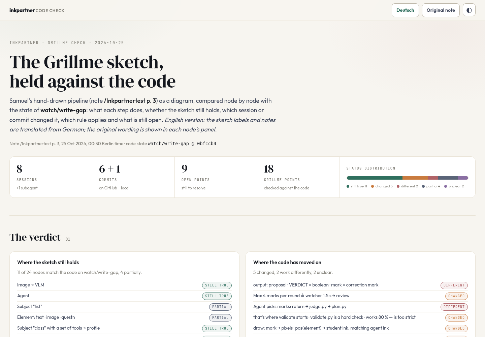
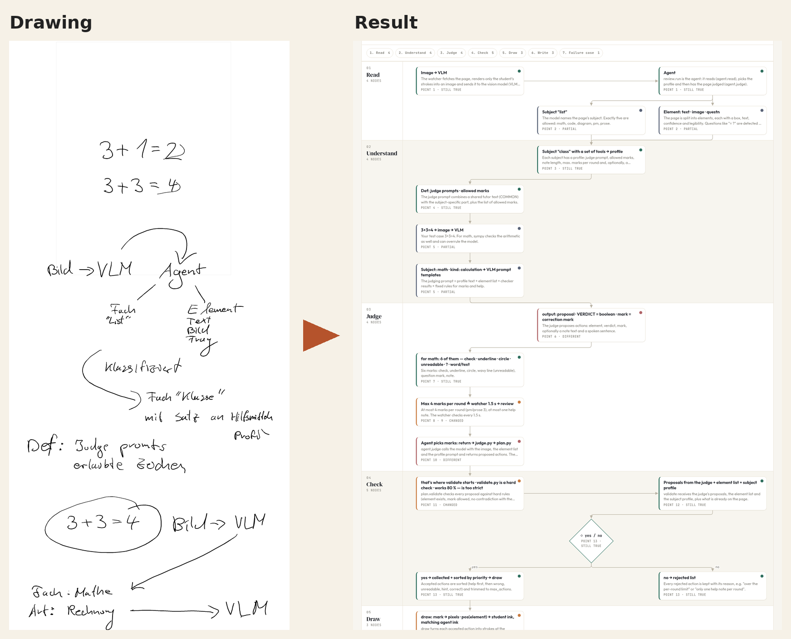
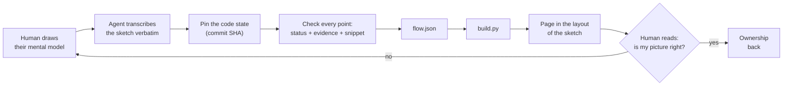
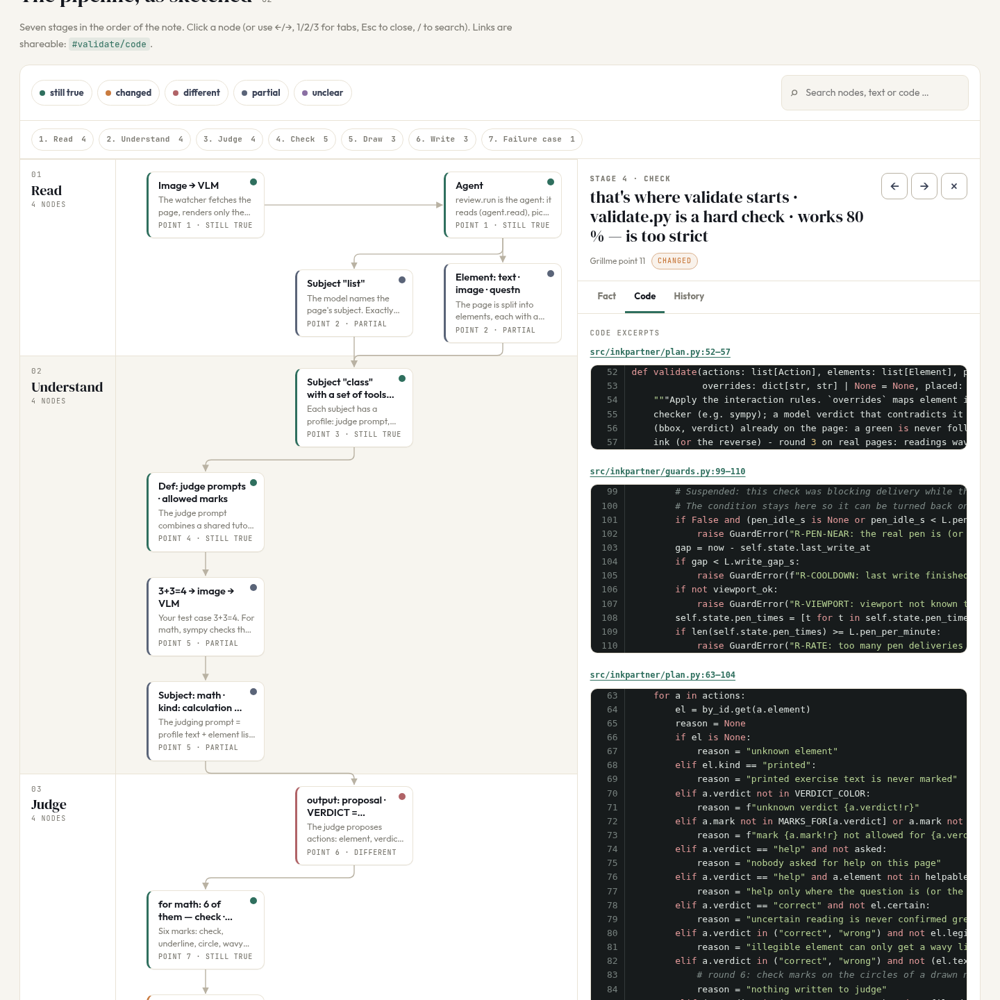
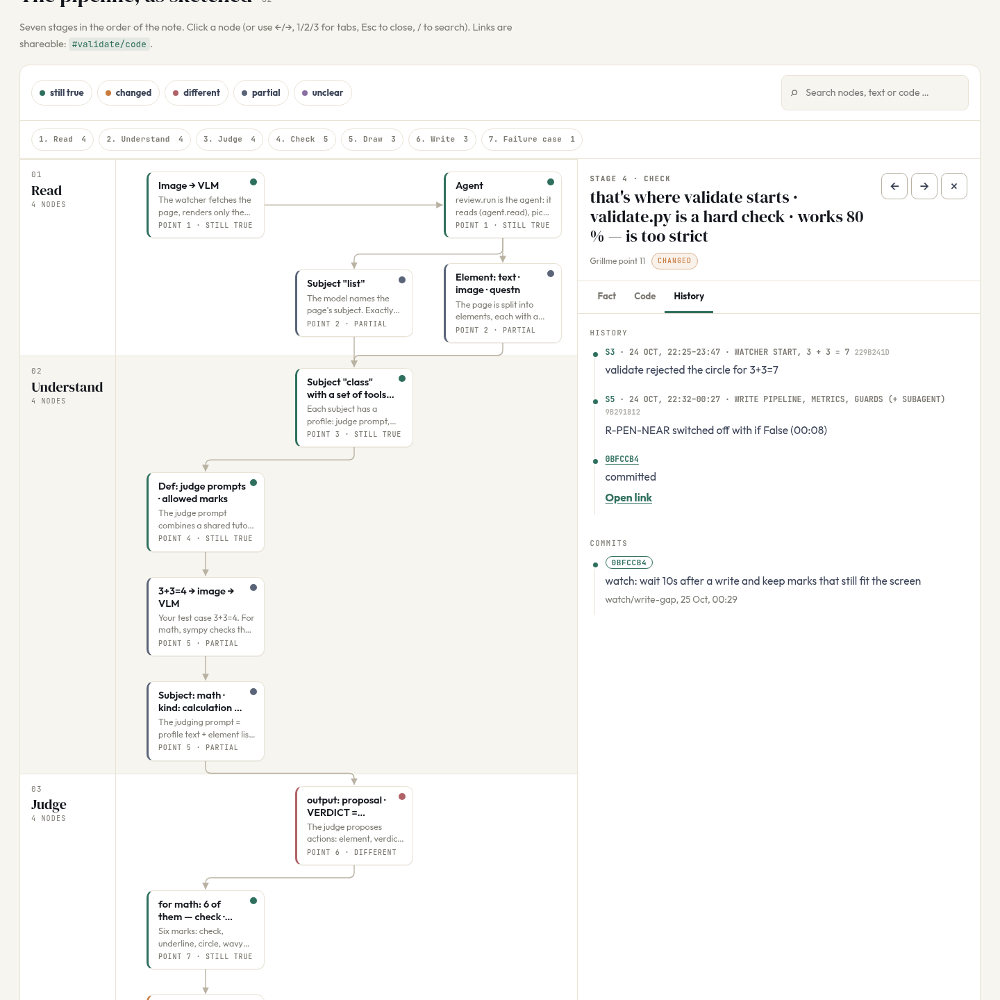
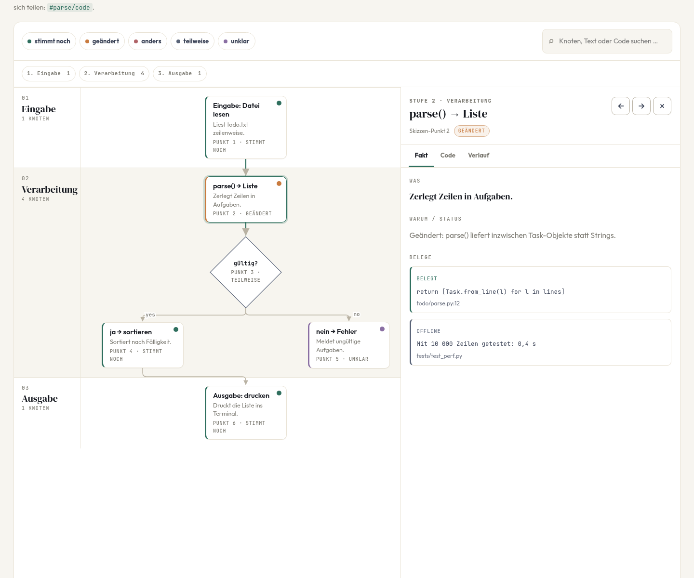

Deutsch: [README.md](README.md)

# Papier-Abgleich

*Papier-Abgleich* is German for “checking it against paper”.

**You draw what you believe your code does. An agent holds the real code against it.**
What comes out is a page where every point of your sketch has a status, a piece of evidence, and the matching code snippet.

### ▶ [View the result live](https://smlfg.github.io/papier-abgleich/examples/inkpartner-grillme/site/inkpartner-fakten.en.html)

[](https://smlfg.github.io/papier-abgleich/examples/inkpartner-grillme/site/inkpartner-fakten.en.html)

## Drawing → Result

On the left a real hand drawing on the reMarkable, produced after roughly 20 hours of agentic work on the *inkpartner* project, from memory and without looking at the code. On the right the same sketch as a page: every node with a status (still true, changed, different, partial, unclear), a code snippet, and a history.



The drawing itself is in German. On the English page, every sketch label is translated, and each node's panel also shows the original German wording.

|| |
|---|---|
| 🌐 **In the browser** | [smlfg.github.io/…/inkpartner-fakten.en.html](https://smlfg.github.io/papier-abgleich/examples/inkpartner-grillme/site/inkpartner-fakten.en.html) |
| 📄 **As a single file** | [`examples/inkpartner-grillme/site/inkpartner-fakten.en.html`](examples/inkpartner-grillme/site/inkpartner-fakten.en.html): download, double-click, done (CSS, JS and sketch embedded) |
| ✏️ **All original drawings** | [`examples/inkpartner-grillme/zeichnungen/`](examples/inkpartner-grillme/zeichnungen/) |

**The result in numbers:** 18 sketch points → 24 nodes in 7 stages. 11 are still true, 5 were changed, 4 are partial, 2 work differently, 2 are unclear; plus 9 open questions.

## Try it yourself

Requirement: Python 3.9 or newer, standard library only. Chrome is optional and only needed for verification and screenshots.

```bash
git clone git@github.com:smlfg/papier-abgleich.git
cd papier-abgleich

# Build the example
python3 build.py examples/minimal
open examples/minimal/site/minimal.html        # Linux: xdg-open

# Your own project
mkdir -p my-project
cp examples/minimal/{flow.json,project.json} my-project/
cp ~/skizze.png my-project/notiz.png
# Fill in flow.json (format: docs/FLOW_SCHEMA.en.md), then:
python3 build.py my-project --name my-project.html
```

`build.py` validates the data before building: required fields, valid statuses and markers, arrows pointing to existing nodes. It produces two outputs:

| Output | Purpose |
|---|---|
| `site/index.html` + `style.css` + `app.js` + image | for further development |
| `site/<name>.html` | **a single file**, CSS, JS and image embedded; for sharing or archiving |

### Tools

| Command | Purpose |
|---|---|
| `python3 tools/snippet.py <repo> <sha> <path> <from> <to> [--github owner/name]` | fetch a code snippet verbatim from a commit (permalink only if pushed) |
| `python3 tools/verify.py <page.html> [#node/code]` | render the page headless, count nodes, arrows and lanes, report JS errors |
| `tools/shots.sh <page.html> <folder> [node-id]` | screenshots (overview, panel, mobile, dark) |

## The problem

With coding agents, one evening produces more code than you can read in a week. The tests are green and the commits have good names, but to the question *“What actually happens when I put the pen down?”* you no longer have a confident answer. The project no longer belongs to you.

More summaries from the agent hardly help: you read *its* picture of the code, not your own.

## The idea

The direction is reversed.

1. **The human draws on paper** (or on an e-ink tablet), without looking at the code, how they believe the system works.
2. **The agent reads the sketch verbatim** and checks every point against a fixed commit.
3. Every point gets one of five statuses, a verbatim piece of evidence, and the code snippet to go with it.
4. Out of this comes a **page in the layout of the sketch**: you recognise your own drawing again and immediately see where it no longer holds.

| Status (ID) | Meaning |
|---|---|
| ✅ still true (`stimmt-noch`) | sketch and code agree |
| 🔄 changed (`geaendert`) | it used to be like that, but has since been changed |
| ↔️ different (`anders`) | works differently than drawn |
| ◐ partial (`teilweise`) | only partly correct |
| ❓ unclear (`unklar`) | cannot be decided from the code; open question |

The IDs in backticks are what you write in `flow.json`. They stay German in both language versions.

On top of that comes an **evidence model**: every fact carries a verbatim quote and a marker for how well it is backed up:

| Marker (ID) | English label on the page | Meaning |
|---|---|---|
| `BELEGT` | verified in code | proven in the code at the pinned commit |
| `GERAET` | seen on device | observed on the real device |
| `OFFLINE` | offline only | shown only in tests or offline runs, not yet on the device |
| `HYPOTHESE` | hypothesis | assumed, not yet checked |

Evidence quotes stay in their original language. The English page translates only the surrounding text.

## Workflow



The complete workflow with roles, quality rules, and artefacts is in [`docs/WORKFLOW.en.md`](docs/WORKFLOW.en.md). As an agent skill it lives at [`skills/papier-abgleich/SKILL.en.md`](skills/papier-abgleich/SKILL.en.md).

## Example: inkpartner

[`examples/inkpartner-grillme/`](examples/inkpartner-grillme/) is the real case this workflow grew out of. inkpartner is a study aid for the reMarkable tablet: you write with the pen, an agent answers on the paper.

Next to the Grillme sketch you will also find the other test pages from the same note: pages on which inkpartner itself answered (arithmetic rule, Pascal's triangle) – in other words, what the project is actually about.

| Code panel for a node | History: when what changed |
|---|---|
|  |  |

Rebuild it:

```bash
python3 build.py examples/inkpartner-grillme --name inkpartner-fakten.html               # German
python3 build.py examples/inkpartner-grillme --lang en --name inkpartner-fakten.en.html  # English
python3 tools/verify.py examples/inkpartner-grillme/site/inkpartner-fakten.en.html
# {"nodes": 24, "arrows": 24, "lanes": 7, "undefined": false, "errors": []}
```

[`examples/minimal/`](examples/minimal/) is a small, made-up example (a todo CLI) with all the fields, including diamonds and evidence:



*(This screenshot shows the German interface.)*

## English version

`build.py --lang en` builds the page with an English interface: statuses, markers, tabs, and headings. If the project folder contains `flow.en.json` and `project.en.json`, those are used for the content. Otherwise the content from `flow.json` and `project.json` is used as it is. Further details:

- A translated node can keep the original sketch wording in `label_orig`. The panel then shows it as “Original sketch label”.
- `lang_switch` in `project.json` adds a link to the other language version to the top bar.
- The multi-file English build is written as `site/index.en.html`. It shares `style.css` and `app.js` with the German `index.html`.

Details: [`docs/FLOW_SCHEMA.en.md`](docs/FLOW_SCHEMA.en.md).

## The page

- **Sketch layout:** lanes for stages, nodes in the order of the drawing, diamonds for decisions.
- **One panel per node** with the tabs **Fact** (status, reasoning, numbers, rules, evidence), **Code** (verbatim snippets with permalink) and **History** (sessions and commits).
- **Deep links:** `#node`, `#node/code`, `#node/verlauf`; filter `?status=geaendert`; `?theme=dark`; `?original=1` shows the original sketch.
- **Honest about gaps:** commits that exist only locally appear without a link; open questions are entries of their own, not footnotes.

## Repo layout

```
build.py                    Validate and build (standard library only)
templates/                  index.html, style.css, app.js
tools/                      snippet.py, verify.py, shots.sh
docs/WORKFLOW.en.md         Workflow, roles, quality rules
docs/FLOW_SCHEMA.en.md      Format of flow.json and project.json
skills/papier-abgleich/     The workflow as an agent skill
examples/inkpartner-grillme The real case (sketch, notes, data, finished page)
examples/minimal            Small example with all fields
video/                      Preparation of an explainer video (German only)
```

## Ground rules

- **Never invent anything.** Every code snippet comes from `git show <sha>:<path>`, every link points to a pushed SHA.
- **The sketch is taken over verbatim**, typos included. Corrections go into the status, not the label. In a translated version, `label_orig` keeps the verbatim wording.
- **“Unclear” is a valid result.** An open question is better than a guessed answer.
- **The human decides.** The agent delivers the evidence; the judgement “does my picture still hold?” is the human's.

---

© 2026 Samuel Flg. All rights reserved. Not an open-source project; use or redistribution only by prior agreement.
