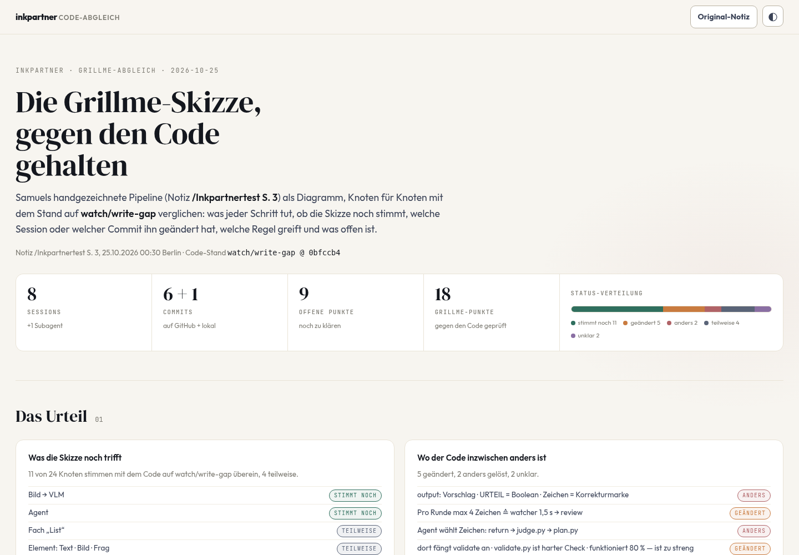
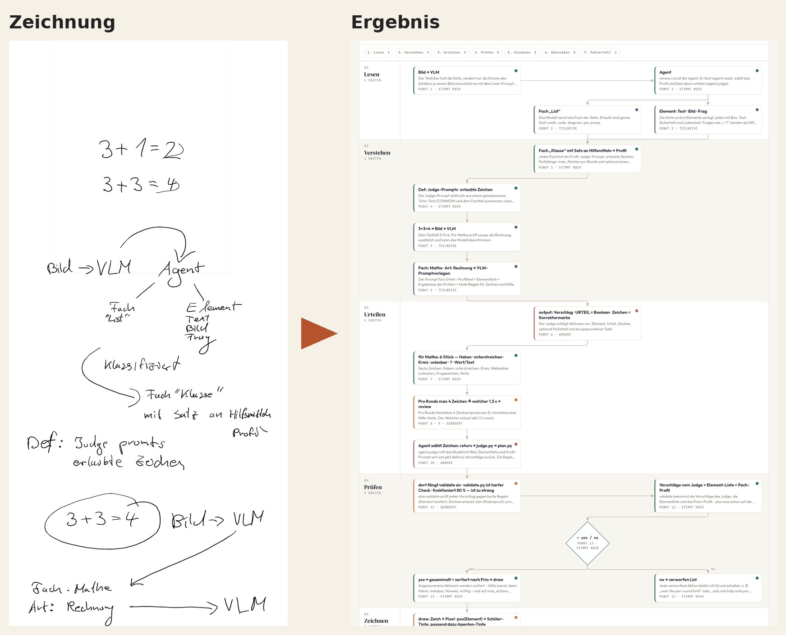
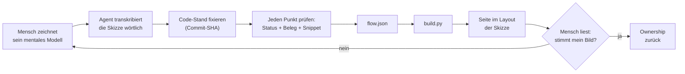
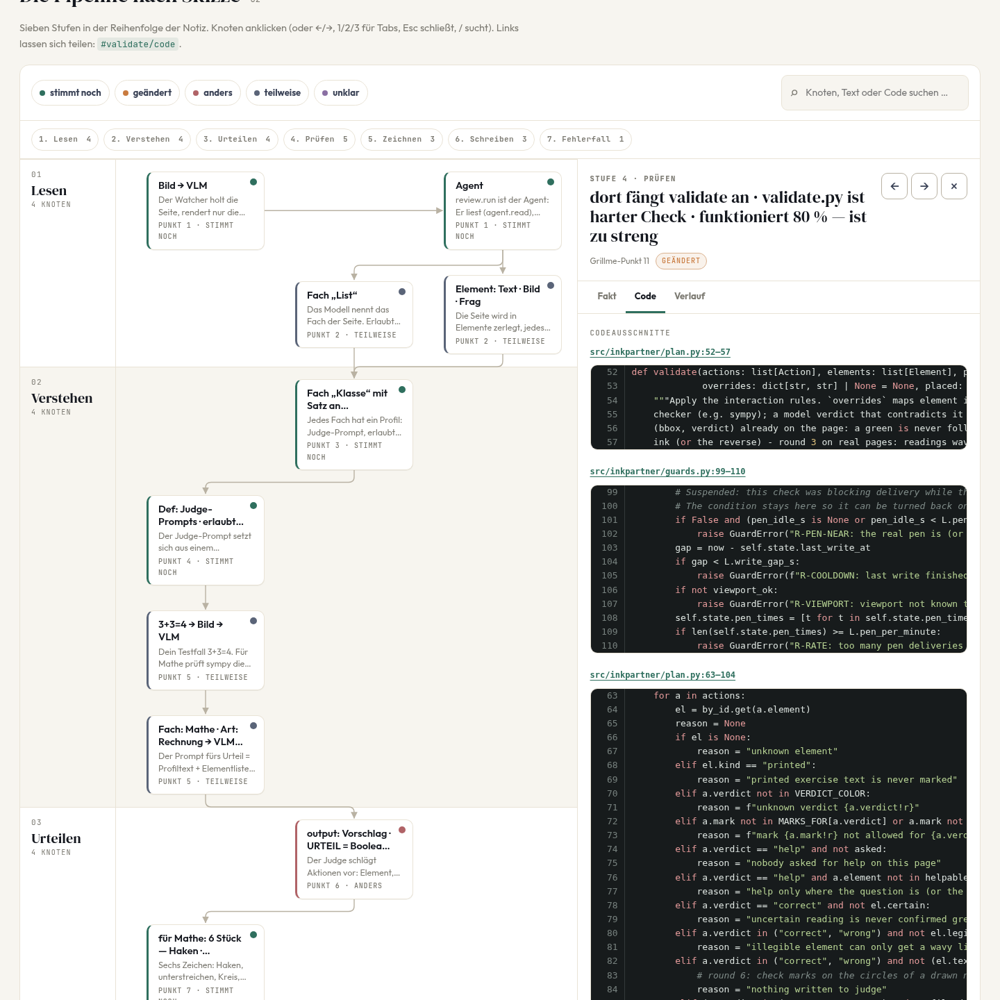
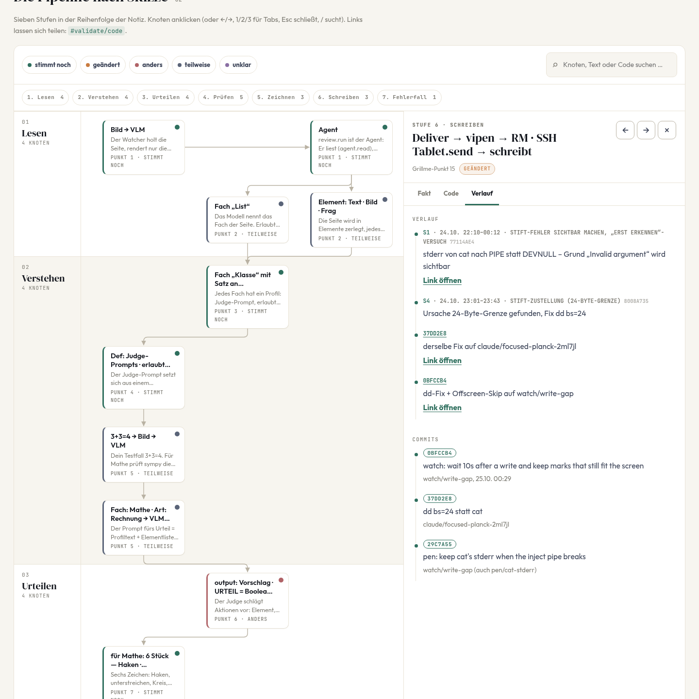

# Papier-Abgleich

**Du zeichnest, was du glaubst, dass dein Code tut. Ein Agent hält den echten Code dagegen.**
Heraus kommt eine Seite, auf der jeder Punkt deiner Skizze einen Status, einen Beleg und den passenden Code-Ausschnitt hat.

### ▶ [Ergebnis live ansehen](https://smlfg.github.io/papier-abgleich/examples/inkpartner-grillme/site/inkpartner-fakten.html)

[](https://smlfg.github.io/papier-abgleich/examples/inkpartner-grillme/site/inkpartner-fakten.html)

## Zeichnung → Ergebnis

Links eine echte Handzeichnung auf dem reMarkable, nach rund 20 Stunden agentischer Arbeit am Projekt *inkpartner*, aus dem Kopf und ohne Blick in den Code. Rechts dieselbe Skizze als Seite: jeder Knoten mit Status (stimmt noch, geändert, anders, teilweise, unklar), Code-Ausschnitt und Verlauf.



| | |
|---|---|
| 🌐 **Im Browser** | [smlfg.github.io/…/inkpartner-fakten.html](https://smlfg.github.io/papier-abgleich/examples/inkpartner-grillme/site/inkpartner-fakten.html) |
| 📄 **Als eine Datei** | [`examples/inkpartner-grillme/site/inkpartner-fakten.html`](examples/inkpartner-grillme/site/inkpartner-fakten.html): herunterladen, doppelklicken, fertig (CSS, JS und Skizze eingebettet) |
| ✏️ **Alle Original-Zeichnungen** | [`examples/inkpartner-grillme/zeichnungen/`](examples/inkpartner-grillme/zeichnungen/) |

**Ergebnis in Zahlen:** 18 Skizzen-Punkte → 24 Knoten in 7 Stufen. 11 stimmen noch, 5 wurden geändert, 4 stimmen teilweise, 2 funktionieren anders, 2 sind unklar; dazu 9 offene Fragen.

## Selbst ausprobieren

Voraussetzung: Python 3.9 oder neuer, nur die Standardbibliothek. Chrome ist optional und wird nur für Prüfung und Screenshots gebraucht.

```bash
git clone git@github.com:smlfg/papier-abgleich.git
cd papier-abgleich

# Beispiel bauen
python3 build.py examples/minimal
open examples/minimal/site/minimal.html        # Linux: xdg-open

# Eigenes Projekt
mkdir -p mein-projekt
cp examples/minimal/{flow.json,project.json} mein-projekt/
cp ~/skizze.png mein-projekt/notiz.png
# flow.json füllen (Format: docs/FLOW_SCHEMA.md), dann:
python3 build.py mein-projekt --name mein-projekt.html
```

`build.py` prüft die Daten vor dem Bauen: Pflichtfelder, gültige Status und Marker, Pfeile auf vorhandene Knoten. Es erzeugt zwei Ausgaben:

| Ausgabe | Zweck |
|---|---|
| `site/index.html` + `style.css` + `app.js` + Bild | zum Weiterentwickeln |
| `site/<name>.html` | **eine einzige Datei**, CSS, JS und Bild eingebettet; zum Verschicken oder Archivieren |

### Werkzeuge

| Befehl | Zweck |
|---|---|
| `python3 tools/snippet.py <repo> <sha> <pfad> <von> <bis> [--github owner/name]` | Code-Ausschnitt wörtlich aus einem Commit holen (Permalink nur, wenn gepusht) |
| `python3 tools/verify.py <seite.html> [#knoten/code]` | Seite headless rendern, Knoten, Pfeile und Bänder zählen, JS-Fehler melden |
| `tools/shots.sh <seite.html> <ordner> [knoten-id]` | Screenshots (Übersicht, Panel, mobil, dunkel) |

## Das Problem

Mit Coding-Agenten entsteht in einem Abend mehr Code, als man in einer Woche lesen kann. Die Tests sind grün und die Commits haben gute Namen, aber auf die Frage *„Was passiert eigentlich, wenn ich den Stift aufsetze?“* hat man keine sichere Antwort mehr. Das Projekt gehört einem nicht mehr.

Mehr Zusammenfassungen vom Agenten helfen dabei kaum: Man liest *sein* Bild des Codes, nicht das eigene.

## Die Idee

Die Richtung wird umgedreht.

1. **Der Mensch zeichnet auf Papier** (oder auf einem E-Ink-Tablet), ohne in den Code zu schauen, wie er glaubt, dass das System funktioniert.
2. **Der Agent liest die Skizze wörtlich** und prüft jeden Punkt gegen einen festen Commit.
3. Jeder Punkt bekommt einen von fünf Status, einen wörtlichen Beleg und den Code-Ausschnitt dazu.
4. Daraus entsteht eine **Seite im Layout der Skizze**: Man erkennt die eigene Zeichnung wieder und sieht sofort, wo sie nicht mehr stimmt.

| Status | Bedeutung |
|---|---|
| ✅ `stimmt-noch` | Skizze und Code stimmen überein |
| 🔄 `geaendert` | war so, wurde inzwischen geändert |
| ↔️ `anders` | funktioniert anders als gezeichnet |
| ◐ `teilweise` | stimmt nur zum Teil |
| ❓ `unklar` | aus dem Code nicht entscheidbar, offene Frage |

Dazu kommt ein **Belegmodell**: Jeder Fakt trägt ein wörtliches Zitat und einen Marker, wie gut er belegt ist (`BELEGT` im Code, `GERAET` auf dem echten Gerät beobachtet, `OFFLINE` nur im Test, `HYPOTHESE` vermutet).

## Ablauf



Der vollständige Ablauf mit Rollen, Qualitätsregeln und Artefakten steht in [`docs/WORKFLOW.md`](docs/WORKFLOW.md). Als Agent-Skill liegt er unter [`skills/papier-abgleich/SKILL.md`](skills/papier-abgleich/SKILL.md).

## Beispiel: inkpartner

[`examples/inkpartner-grillme/`](examples/inkpartner-grillme/) ist der echte Fall, aus dem dieser Ablauf entstanden ist. inkpartner ist eine Lernhilfe für das reMarkable-Tablet: Man schreibt mit dem Stift, ein Agent antwortet auf dem Papier.

Neben der Grillme-Skizze liegen dort auch die übrigen Testseiten aus derselben Notiz: Seiten, auf denen inkpartner selbst geantwortet hat (Rechenregel, Pascal-Dreieck) – also das, worum es im Projekt eigentlich geht.

| Code-Panel zu einem Knoten | Verlauf: wann sich was geändert hat |
|---|---|
|  |  |

Neu bauen:

```bash
python3 build.py examples/inkpartner-grillme --name inkpartner-fakten.html
python3 tools/verify.py examples/inkpartner-grillme/site/inkpartner-fakten.html
# {"nodes": 24, "arrows": 24, "lanes": 7, "undefined": false, "errors": []}
```

[`examples/minimal/`](examples/minimal/) ist ein kleines, erfundenes Beispiel (ein Todo-CLI) mit allen Feldern, auch Rauten und Belegen:


## Die Seite

- **Skizzen-Layout:** Bänder für Stufen, Knoten in der Reihenfolge der Zeichnung, Rauten für Entscheidungen.
- **Panel pro Knoten** mit den Tabs **Fakt** (Status, Begründung, Zahlen, Regeln, Belege), **Code** (wörtliche Ausschnitte mit Permalink) und **Verlauf** (Sessions und Commits).
- **Deep-Links:** `#knoten`, `#knoten/code`, `#knoten/verlauf`; Filter `?status=geaendert`; `?theme=dark`; `?original=1` zeigt die Original-Skizze.
- **Ehrlich bei Lücken:** Commits, die nur lokal existieren, erscheinen ohne Link; offene Fragen sind eigene Einträge, keine Fußnoten.

## Aufbau des Repos

```
build.py                    Validieren und bauen (nur Standardbibliothek)
templates/                  index.html, style.css, app.js
tools/                      snippet.py, verify.py, shots.sh
docs/WORKFLOW.md            Ablauf, Rollen, Qualitätsregeln
docs/FLOW_SCHEMA.md         Format von flow.json und project.json
skills/papier-abgleich/     Der Ablauf als Agent-Skill
examples/inkpartner-grillme Der echte Fall (Skizze, Notizen, Daten, fertige Seite)
examples/minimal            Kleines Beispiel mit allen Feldern
video/                      Vorbereitung eines Erklärvideos
```

## Grundregeln

- **Nichts erfinden.** Jeder Code-Ausschnitt kommt aus `git show <sha>:<pfad>`, jeder Link zeigt auf einen gepushten SHA.
- **Die Skizze wird wörtlich übernommen**, auch mit Tippfehlern. Korrigiert wird im Status, nicht im Label.
- **„Unklar“ ist ein gültiges Ergebnis.** Lieber eine offene Frage als eine geratene Antwort.
- **Der Mensch entscheidet.** Der Agent liefert Belege, das Urteil „stimmt mein Bild?“ fällt der Mensch.

---

© 2026 Samuel Flg. Alle Rechte vorbehalten (All rights reserved). Kein Open-Source-Projekt; Nutzung oder Weitergabe nur nach Rücksprache.
